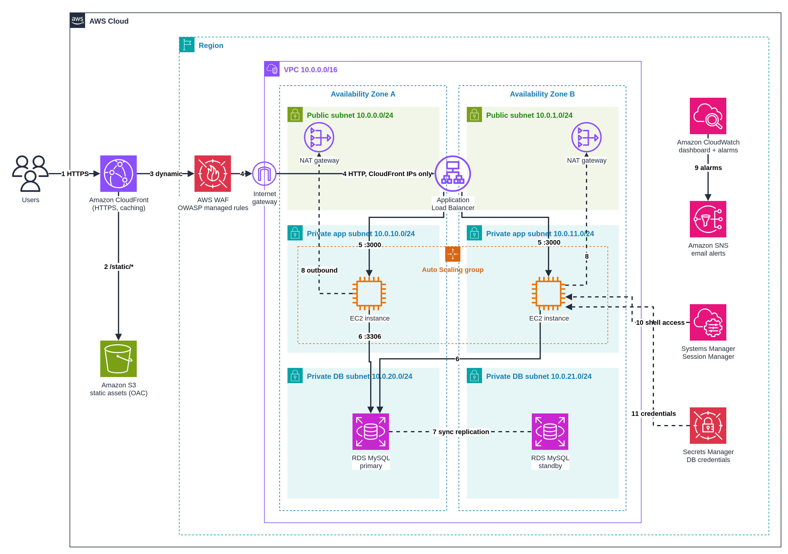

# Scalable Web Application with ALB and Auto Scaling on AWS


A production-style, highly available web application deployed on Amazon EC2 behind an Application Load Balancer, with Auto Scaling across two Availability Zones, CloudFront for edge caching, AWS WAF for OWASP Top 10 protection and a Multi-AZ Amazon RDS database. All compute and data live in private subnets, and there is no SSH or bastion host: operators connect through AWS Systems Manager Session Manager.

> Graduation project for the **AWS Solutions Architect – Associate** track (Manara). Project 1: *Scalable Web Application with ALB and Auto Scaling*.

## Table of contents

- [Solution overview](#solution-overview)
- [Architecture diagram](#architecture-diagram)
- [Architecture walkthrough](#architecture-walkthrough)
- [AWS services used](#aws-services-used)
- [Network design](#network-design)
- [Security](#security)
- [High availability and scaling](#high-availability-and-scaling)
- [Monitoring and alerting](#monitoring-and-alerting)
- [Well-Architected Framework alignment](#well-architected-framework-alignment)
- [Design decisions](#design-decisions)
- [Deployment](#deployment)
- [Testing the solution](#testing-the-solution)
- [Cost estimate](#cost-estimate)
- [Cleanup](#cleanup)
- [Extending the solution](#extending-the-solution)
- [Repository structure](#repository-structure)

## Solution overview

A single web server is a single point of failure. It can't absorb traffic spikes, and patching it means downtime. This solution shows the standard AWS answer for an EC2-based workload:

- **Stateless web tier** in an Auto Scaling group spread across two AZs, replaced automatically when unhealthy and scaled on CPU.
- **Managed relational database** (RDS MySQL Multi-AZ) with a synchronous standby and automatic failover.
- **Layered security**: CloudFront → WAF → ALB → app → database, each layer reachable only from the one before it.
- **Edge delivery**: static assets are served from S3 through CloudFront, so instances only handle dynamic requests.
- **Operability**: CloudWatch dashboard, alarms and SNS email alerts, plus Session Manager access with no open ports.

The sample application is a small **notes app** (Node.js + Express + MySQL). Every page shows the **instance ID and Availability Zone** that served it, which makes load balancing and failover visible during a demo.

The whole stack is defined in a single CloudFormation template: [`deployment/main.yaml`](deployment/main.yaml).

## Architecture diagram



The editable source is [`architecture/architecture.drawio`](architecture/architecture.drawio) (open it with [draw.io](https://app.diagrams.net)).

## Architecture walkthrough

The numbers match the arrows in the diagram.

1. **Users** reach the application over HTTPS at the **Amazon CloudFront** domain. CloudFront terminates TLS and redirects any HTTP request to HTTPS.
2. Requests for **`/static/*`** (CSS, JavaScript) are served from a private **Amazon S3** bucket through **Origin Access Control (OAC)** and cached at the edge (`CachingOptimized` policy). The bucket blocks all public access, and only this distribution can read it.
3. All other (dynamic) requests are forwarded to the ALB origin with caching disabled.
4. Traffic enters the VPC through the **Internet Gateway** to the **Application Load Balancer** in the public subnets. The ALB security group accepts traffic **only from CloudFront's origin-facing IP ranges** (AWS managed prefix list), so the ALB can't be reached directly. **AWS WAF** is attached to the ALB and inspects every request with the AWS managed rule groups for common OWASP Top 10 attacks, SQL injection and known bad inputs.
5. The ALB forwards to healthy **EC2 instances** (port 3000) in the private app subnets. Instances belong to an **Auto Scaling group** across both AZs, and the target group health check (`/health`) removes failed instances from rotation.
6. Instances connect to **Amazon RDS for MySQL** (port 3306) in the private DB subnets.
7. RDS is **Multi-AZ**: writes are replicated synchronously to a standby in the second AZ, which is promoted automatically if the primary fails.
8. Instances reach the internet (OS packages, the app's Git repository, AWS APIs) only outbound, through a **NAT Gateway in their own AZ**.
9. **Amazon CloudWatch** collects ALB, EC2, Auto Scaling and RDS metrics into a dashboard. Alarms notify an **Amazon SNS** topic, which emails the operator.
10. Administrators open a shell with **AWS Systems Manager Session Manager**. There is no SSH, no port 22, no key pairs and no bastion host.
11. The database password is generated and rotated by RDS in **AWS Secrets Manager**. Instances read it at service start using their IAM role, so credentials never appear in code, user data or CloudFormation parameters.

## AWS services used

| Service | Purpose in this solution |
|---|---|
| Amazon VPC | Isolated network: 2 AZs × (public, private app, private DB) subnets, route tables, IGW, NAT Gateways, security groups, network ACLs |
| Amazon EC2 + Auto Scaling | Launch template (Amazon Linux 2023, IMDSv2, encrypted EBS), ASG with target tracking and step scaling policies |
| Elastic Load Balancing (ALB) | Layer 7 load balancing, health checks, cross-AZ distribution |
| AWS WAF | Web ACL with AWS managed rule groups (Common/OWASP, SQLi, Known Bad Inputs) |
| Amazon CloudFront | HTTPS endpoint, edge caching of static assets, origin routing (`/static/*` → S3, default → ALB) |
| Amazon S3 | Private storage for static assets (OAC, Block Public Access, SSE-S3) |
| Amazon RDS for MySQL | Multi-AZ database with automated backups and encrypted storage |
| AWS Secrets Manager | RDS-managed master credentials with automatic rotation |
| AWS Systems Manager | Session Manager for bastion-free, audited shell access |
| Amazon CloudWatch | Dashboard, metrics and alarms |
| Amazon SNS | Email notifications for alarms |
| AWS IAM | Least-privilege instance role (SSM core + read one secret) |
| AWS CloudFormation | Infrastructure as code for the whole stack |

## Network design

| Subnet | AZ A | AZ B | Route to internet | Contains |
|---|---|---|---|---|
| Public | 10.0.0.0/24 | 10.0.1.0/24 | Internet Gateway | ALB nodes, NAT Gateways |
| Private app | 10.0.10.0/24 | 10.0.11.0/24 | NAT Gateway in the same AZ | EC2 instances (ASG) |
| Private DB | 10.0.20.0/24 | 10.0.21.0/24 | **None** | RDS primary / standby |

- **Route tables**: one public route table (`0.0.0.0/0 → IGW`). One private route table **per AZ** (`0.0.0.0/0 → NAT Gateway in that AZ`), so an AZ outage doesn't break outbound access for the other AZ. One DB route table with only the local VPC route.
- **Network ACLs** (stateless, subnet level) add a second layer on top of security groups:
  - *Public NACL*: inbound 80/443 and ephemeral ports 1024–65535 from anywhere, plus all traffic from the VPC CIDR. All outbound allowed.
  - *Private NACL* (app + DB subnets): inbound from the VPC CIDR and TCP ephemeral return traffic only. All outbound allowed. Nothing on the internet can start a connection into these subnets.

## Security

Defense in depth, from the edge to the data:

| Layer | Control |
|---|---|
| Edge | CloudFront enforces HTTPS (redirect-to-https, HTTP/2 and HTTP/3) |
| Application firewall | AWS WAF managed rules block common OWASP Top 10 patterns, SQL injection and known exploit payloads before they reach the app |
| Load balancer | ALB SG allows port 80 **only** from the CloudFront origin-facing prefix list. ALB drops invalid HTTP header fields |
| App tier | Instances live in private subnets with no public IPs. App SG allows port 3000 **only from the ALB SG**, with **no SSH rule at all** |
| Data tier | DB SG allows 3306 **only from the App SG**. DB subnets have no internet route. Storage is encrypted at rest |
| Secrets | RDS-managed master password in Secrets Manager (auto-rotated). The instance role can read only that one secret |
| Instance hardening | IMDSv2 required (protects against SSRF credential theft), encrypted EBS, app runs as an unprivileged system user |
| Access | Session Manager replaces bastion hosts and SSH keys. Sessions are IAM-controlled and logged in CloudTrail |
| Static content | S3 Block Public Access is on, ownership is enforced, and the bucket policy allows only this CloudFront distribution (OAC with `AWS:SourceArn`) |
| Application | Parameterized SQL queries, input length validation, and the frontend renders user content with `textContent` (no HTML injection) |

## High availability and scaling

- **Multi-AZ everywhere**: ALB nodes, NAT Gateways, EC2 instances (min 2, one per AZ) and the RDS standby all span two AZs.
- **Self-healing**: the ASG uses **ELB health checks**, so an instance that fails `/health` is replaced automatically.
- **Target tracking scaling**: keeps average CPU across the group at **50%**, scaling out and in automatically (min 2, max 6).
- **Step scaling**: when CPU stays above **80%** for 3 minutes, the `CpuHighAlarm` adds **+1** instance (80–90%) or **+2** instances (>90%) for a faster response to sudden spikes.
- **Rolling updates**: changes to the launch template replace instances one at a time, keeping at least one in service.
- **Database failover**: RDS Multi-AZ fails over to the standby automatically (typically 60–120 seconds). The DNS endpoint stays the same, so the app reconnects without config changes.

## Monitoring and alerting

The stack creates a CloudWatch dashboard (`<stack-name>-dashboard`) with:

- ALB request count, target 5xx and ELB 5xx
- ALB target response time (p90)
- Healthy / unhealthy target count
- ASG average CPU and in-service instance count
- RDS CPU, connections and free storage

Alarms (all notify the SNS topic, which emails `AlertEmail`):

| Alarm | Condition | Action |
|---|---|---|
| `CpuHighAlarm` | ASG average CPU > 80% for 3 min | Step scaling + email |
| `Alb5xxAlarm` | > 10 target 5xx per minute for 5 min | Email |
| `UnhealthyHostsAlarm` | ≥ 1 unhealthy target for 3 min | Email |
| `RdsCpuAlarm` | RDS CPU > 80% for 5 min | Email |
| `RdsStorageAlarm` | Free storage < 2 GiB | Email |

## Well-Architected Framework alignment

| Pillar | How it is addressed |
|---|---|
| Operational excellence | Everything is in CloudFormation. Dashboard and alarms. Session Manager instead of SSH. Rolling updates |
| Security | Layered SGs and NACLs, private subnets, WAF, OAC, IMDSv2, encryption at rest, Secrets Manager with rotation, least-privilege IAM |
| Reliability | Multi-AZ for every tier, ELB health checks with ASG self-healing, RDS automatic failover, per-AZ NAT Gateways, 7-day automated backups |
| Performance efficiency | CloudFront edge caching for static assets, Auto Scaling on demand, HTTP/2 and HTTP/3 at the edge |
| Cost optimization | Burstable t3 instances, scale-in when idle, static content offloaded from EC2, gp3 storage, CloudFront `PriceClass_100` |
| Sustainability | Capacity follows demand (scale-in), managed services share underlying infrastructure |

## Design decisions

- **The `/health` check doesn't touch the database.** If it did, an RDS failover would mark *every* instance unhealthy and the ASG would terminate the whole fleet. `/health` is a liveness check. `/health/db` exists for manual or deep checks.
- **WAF is on the ALB (regional scope)**, as the project brief asks. Because requests arrive through CloudFront, the source IP WAF sees is a CloudFront edge, so IP-based rate limiting is left out on purpose. It belongs in a CloudFront-scope web ACL (see [Extending the solution](#extending-the-solution)).
- **Credentials are fetched at service start.** The systemd unit fetches the secret in `ExecStartPre`. If RDS rotates the password, the app gets an access-denied error, exits, and systemd restarts it with the fresh secret.
- **One NAT Gateway per AZ** costs more than a single shared one, but it removes a cross-AZ single point of failure.
- **The RDS `DeletionPolicy` is `Snapshot`**, so deleting the stack keeps a final snapshot of the data.
- **Instances bootstrap from Git**: user data clones this repository and runs `npm ci`. That keeps the template self-contained and avoids building a custom AMI. A golden AMI (EC2 Image Builder) would cut boot time in production.

## Deployment

> This submission covers design and code. The template passes `cfn-lint` and the app tests pass, but the stack wasn't deployed. The steps below are the procedure to run it. The stack costs money while it runs (see [Cost estimate](#cost-estimate)).

### Prerequisites

- An AWS account and the [AWS CLI v2](https://docs.aws.amazon.com/cli/latest/userguide/getting-started-install.html), configured with permissions to create the resources above
- This repository pushed to a **public** GitHub repo (instances clone it at boot)

### 1. Look up the CloudFront prefix list ID for your region

```bash
aws ec2 describe-managed-prefix-lists \
  --filters Name=prefix-list-name,Values=com.amazonaws.global.cloudfront.origin-facing \
  --query 'PrefixLists[0].PrefixListId' --output text
```

### 2. Deploy the stack

```bash
aws cloudformation deploy \
  --stack-name notes-app \
  --template-file deployment/main.yaml \
  --capabilities CAPABILITY_IAM \
  --parameter-overrides \
      AlertEmail=you@example.com \
      RepoUrl=https://github.com/<your-user>/<your-repo>.git \
      RepoBranch=main \
      CloudFrontPrefixListId=<id-from-step-1>
```

Creation takes about 20–30 minutes (RDS Multi-AZ and CloudFront take the longest).

### 3. Upload the static assets

```bash
BUCKET=$(aws cloudformation describe-stacks --stack-name notes-app \
  --query "Stacks[0].Outputs[?OutputKey=='StaticBucketName'].OutputValue" --output text)
aws s3 sync app/public "s3://$BUCKET/static/"
```

### 4. Confirm the SNS subscription

Open the "AWS Notification – Subscription Confirmation" email and click **Confirm subscription**.

### 5. Open the app

```bash
aws cloudformation describe-stacks --stack-name notes-app \
  --query "Stacks[0].Outputs[?OutputKey=='WebsiteUrl'].OutputValue" --output text
```

### Template parameters

| Parameter | Default | Description |
|---|---|---|
| `AlertEmail` | *(required)* | Receives alarm emails |
| `RepoUrl` / `RepoBranch` | this repo / `main` | Where instances clone the app from |
| `InstanceType` | `t3.micro` | EC2 instance type |
| `DBInstanceClass` | `db.t3.micro` | RDS instance class |
| `MinSize` / `MaxSize` / `DesiredCapacity` | 2 / 6 / 2 | Auto Scaling group capacity |
| `CloudFrontPrefixListId` | `pl-3b927c52` (us-east-1) | CloudFront origin-facing prefix list |
| `LatestAmiId` | AL2023 SSM parameter | AMI is always the latest Amazon Linux 2023 |

### Run the app locally

```bash
cd app
npm install
npm test                                  # route tests, no database needed
DB_HOST=localhost DB_USER=root DB_PASSWORD=secret DB_NAME=notes npm start   # needs a local MySQL
```

## Testing the solution

| What to show | How |
|---|---|
| **Load balancing across AZs** | Refresh the page. The *Served by i-… in us-east-1a/b* line changes. Or run `for i in $(seq 10); do curl -s https://<cf-domain>/api/info; echo; done` |
| **ALB is not directly reachable** | `curl -m 5 http://<LoadBalancerDns>` times out (the SG only allows CloudFront) |
| **S3 is private** | `curl https://<bucket>.s3.amazonaws.com/static/app.js` returns `403 AccessDenied`, while `https://<cf-domain>/static/app.js` works |
| **WAF blocks SQL injection** | `curl -i "https://<cf-domain>/api/notes?id=1%27%20OR%20%271%27%3D%271"` returns `403 Forbidden` |
| **Session Manager (no SSH)** | `aws ssm start-session --target <instance-id>`, or EC2 console → Connect → Session Manager |
| **Auto Scaling scale-out** | In a session: `sudo dnf install -y stress-ng && stress-ng --cpu 2 --timeout 600`. Watch the dashboard and the ASG activity history add instances, then scale back in afterwards |
| **Self-healing** | Terminate an instance in the console. The ASG launches a replacement and the ALB stops routing to the old one |
| **RDS Multi-AZ failover** | `aws rds reboot-db-instance --db-instance-identifier <id> --force-failover`. The app recovers in about 1–2 minutes and instances stay healthy |
| **Alerts** | The stress test or failover triggers alarms, and an email arrives through SNS |

## Cost estimate

Approximate on-demand prices in **us-east-1**, running 24/7 with light traffic. Check them with the [AWS Pricing Calculator](https://calculator.aws/).

| Resource | Monthly (USD) |
|---|---|
| 2 × NAT Gateway (hourly) | ~$66 |
| Application Load Balancer (hourly + LCU) | ~$22 |
| RDS db.t3.micro Multi-AZ + 20 GB gp3 | ~$30 |
| 2 × EC2 t3.micro + EBS | ~$17 |
| Public IPv4 addresses (NAT EIPs + ALB) | ~$15 |
| AWS WAF (web ACL + 3 managed rule groups) | ~$8 |
| CloudWatch dashboard + alarms, Secrets Manager, SNS | ~$4 |
| CloudFront, S3 | ~$0–1 (free tier) |
| **Total** | **≈ $160/month (≈ $5/day)** |

The NAT Gateways are the biggest line item. For a lab you can delete the stack after the demo, or use a single NAT Gateway. That trades away AZ resilience for outbound traffic.

## Cleanup

```bash
BUCKET=$(aws cloudformation describe-stacks --stack-name notes-app \
  --query "Stacks[0].Outputs[?OutputKey=='StaticBucketName'].OutputValue" --output text)
aws s3 rm "s3://$BUCKET" --recursive          # CloudFormation can't delete a non-empty bucket
aws cloudformation delete-stack --stack-name notes-app
aws cloudformation wait stack-delete-complete --stack-name notes-app

# The RDS DeletionPolicy keeps a final snapshot. Delete it when you no longer need it:
aws rds describe-db-snapshots --snapshot-type manual --query 'DBSnapshots[].DBSnapshotIdentifier'
aws rds delete-db-snapshot --db-snapshot-identifier <snapshot-id>
```

## Extending the solution

- **Custom domain (Route 53 + ACM)**: request an ACM certificate in `us-east-1`, add it and an alternate domain name to the CloudFront distribution, and create a Route 53 **alias A/AAAA record** pointing at CloudFront. Add a Route 53 **health check** on `/health` with an alarm for external availability monitoring.
- **End-to-end HTTPS**: add an HTTPS listener on the ALB with an ACM certificate and switch the CloudFront origin to `https-only`.
- **Lock the origin further**: have CloudFront send a secret custom header and add an ALB listener rule that rejects requests without it.
- **CloudFront-scope WAF**: move WAF to the distribution (deployed in `us-east-1`) to add IP rate-based rules and geo blocking at the edge.
- **Aurora MySQL**: read replicas and faster failover. **ElastiCache** for session or query caching.
- **VPC endpoints** for SSM, Secrets Manager and S3 to keep AWS API traffic off the NAT Gateways.
- **Golden AMI** with EC2 Image Builder for faster, more predictable instance launches.
- **CI/CD** with GitHub Actions: `cfn-lint`, `npm test`, then `aws cloudformation deploy`.

## Repository structure

```
.
├── README.md                     # This documentation
├── architecture/
│   ├── architecture.drawio       # Editable architecture diagram (draw.io)
│   └── architecture.png          # Exported diagram used above
├── deployment/
│   └── main.yaml                 # CloudFormation template for the whole stack
└── app/
    ├── package.json
    ├── server.js                 # Express app: notes API, health checks, instance info
    ├── server.test.js            # Route tests (node --test)
    └── public/                   # Static assets, uploaded to S3 under static/
        ├── app.js
        └── style.css
```

## Author

[Youssefbarsoum](https://github.com/Youssefbarsoum). Graduation project, AWS Solutions Architect – Associate (Manara).
